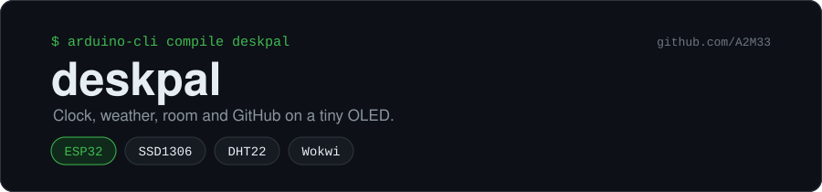
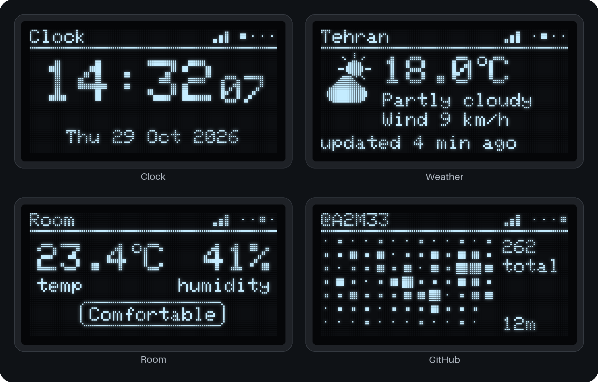
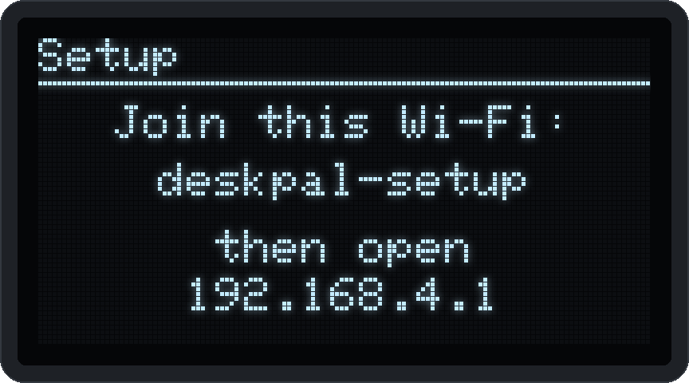

<p align="center"></p>

<p align="center">
  <a href="https://github.com/A2M33/deskpal/actions/workflows/build.yml"></a>
  
  
  <a href="https://github.com/A2M33/deskpal/blob/main/LICENSE"></a>
</p>

A small desk display built on an ESP32. It shows the time, the weather outside, the temperature and humidity in your room, and your recent GitHub activity on a 0.96" OLED screen.

An ESP32 is a cheap microcontroller board (around $5) with Wi-Fi built in. You program it from your computer over USB, and it runs your code on its own as soon as it gets power.



I rendered these on my PC from the drawing code in `deskpal/screens.cpp`, so they match the OLED pixel for pixel. `tools/render` has the script.

## What it shows

The display rotates through four screens, eight seconds each.

1. **Clock**: time and date, synced from the internet (NTP). deskpal works out your time zone from the weather location, daylight saving included. Set `CLOCK_12H` for a 12-hour clock.
2. **Weather**: current temperature, a short description, a small icon and wind speed from [Open-Meteo](https://open-meteo.com). Open-Meteo needs no account or API key. The data refreshes every 15 minutes. With no coordinates set, deskpal finds your city from your IP address (see [Location](#location)). Set `TEMP_FAHRENHEIT` for °F.
3. **Room**: temperature and humidity from a DHT22 sensor, plus a comfort label like "Comfortable" or "Dry".
4. **GitHub**: your contribution grid for the last 12 weeks, plus the total. Busier days get bigger squares, since the screen only has one color. Refreshes every 30 minutes. It works without a token (see [GitHub data](#github-data)).

The button does three things:

- **Press**: jump to the next screen.
- **Hold about a second, then let go**: pause the rotation, or resume it. A pause icon appears in the top bar while rotation is off.
- **Hold 5 seconds**: open the [setup portal](#setup-portal).

If Wi-Fi drops or a website doesn't answer, deskpal keeps showing the last data it got and tells you how old it is. The ESP32 reconnects to Wi-Fi by itself. The web requests run on the ESP32's second core, so the clock and the button keep working while a slow server answers.

## Open in Wokwi

[Wokwi](https://wokwi.com) simulates the ESP32, the screen, the sensor and the button in your browser, with internet access. You don't need any hardware.

<!-- TODO: replace the link below with the public Wokwi project URL once it is published. -->
<!-- [Open deskpal in Wokwi](https://wokwi.com/projects/TODO) -->

To run it:

1. Open the deskpal project in Wokwi.
2. Press the green play button. The first build takes about a minute while Wokwi compiles the code and installs the libraries.
3. Watch the screen. The clock and weather appear after a few seconds, once deskpal has joined the network and looked up your location.
4. Click the button in the diagram to switch screens. Hold it about a second to pause the rotation.
5. Click the DHT22 while the simulation runs and drag its sliders to change the room readings.

deskpal joins Wokwi's virtual Wi-Fi network, `Wokwi-GUEST`, by default. On that network the setup portal stays closed, because Wokwi has nowhere to show it and there is nothing to set up. The GitHub screen shows `@A2M33` from the public contributions page. To show your own account, add a `secrets.h` with `#define GITHUB_USER "your-name"`.

If you want your own copy of the project instead:

1. Go to [wokwi.com](https://wokwi.com), sign in, and start a new project with the **ESP32** board (Arduino template).
2. Open the `sketch.ino` tab and replace its contents with `deskpal/deskpal.ino` from this repo.
3. Open the `diagram.json` tab and replace its contents with `diagram.json` from this repo. The parts and wires appear on the right.
4. Add the libraries. Click the small arrow next to the file tabs, choose **New file**, name it `libraries.txt`, and paste in `libraries.txt` from this repo. You can also add each one from the **Library Manager** tab.
5. Add the remaining code files the same way, with the exact same names: `config.h`, `settings.h`, `settings.cpp`, `portal.h`, `portal.cpp`, `button.h`, `room.h`, `weather.h`, `weather.cpp`, `github.h`, `github.cpp`, `screens.h`, `screens.cpp`.
6. Press the green play button.

You can put a GitHub token in a Wokwi `secrets.h` too, but once you save the project, anyone with the link can read it. Revoke that token when you finish testing.

## Parts

Prices are rough, from the usual online electronics shops.

| Part | Notes | Price |
|---|---|---|
| ESP32 DevKit board | Any "ESP32 DevKit V1" or "DevKitC" with 30 or 38 pins | $5-8 |
| 0.96" OLED, 128x64, SSD1306, I2C | The 4-pin version (GND, VCC, SCL, SDA) | $3-5 |
| DHT22 (AM2302) sensor | A module on a small board saves you a resistor | $3-6 |
| Push button | Any small tactile switch | $0.10 |
| Breadboard and jumper wires | | $5 |
| USB cable | One that carries data; some cables only charge | |

Total: about $20.

## Wiring

| From | To ESP32 pin |
|---|---|
| OLED GND | GND |
| OLED VCC | 3V3 |
| OLED SDA | GPIO 21 |
| OLED SCL | GPIO 22 |
| DHT22 VCC (+) | 3V3 |
| DHT22 data (out) | GPIO 15 |
| DHT22 GND (-) | GND |
| Button, one leg | GPIO 4 |
| Button, other leg | GND |

The button needs no resistor, because the code turns on the ESP32's internal pull-up. If you use a bare DHT22 (4 pins, no board), put a 10 kΩ resistor between its data pin and 3V3.

The OLED's I2C address is set to `0x3C` in `config.h`. A few screens use `0x3D`; the troubleshooting section covers that.

## Setup in Arduino IDE

1. Install [Arduino IDE 2](https://www.arduino.cc/en/software).
2. Add ESP32 support: open **Tools > Board > Boards Manager**, search for `esp32`, and install **esp32 by Espressif Systems**. If it doesn't show up, go to **File > Preferences** and add this to "Additional boards manager URLs", then try again:
   `https://espressif.github.io/arduino-esp32/package_esp32_index.json`
3. Install the libraries from **Tools > Manage Libraries**. Click "Install all" when it offers dependencies.
   - Adafruit SSD1306
   - Adafruit GFX Library
   - DHT sensor library (by Adafruit)
   - ArduinoJson (by Benoit Blanchon, version 7)
   - WiFiManager (by tzapu)
4. Open `deskpal/deskpal.ino`. The IDE shows the other files as tabs.
5. Optional: copy `deskpal/secrets.example.h` to `deskpal/secrets.h` and fill in your Wi-Fi name and password, GitHub username, and anything else you want to change. Every line is optional; delete a line to keep the default. Git ignores `secrets.h`, so your password stays on your computer. You can skip this step and use the [setup portal](#setup-portal) after uploading.
6. Pick **Tools > Board > esp32 > ESP32 Dev Module** and the right port under **Tools > Port**, then click Upload.
7. Open **Tools > Serial Monitor** at 115200 baud to watch the log.

If you prefer the command line:

```sh
arduino-cli core install esp32:esp32
arduino-cli lib install "Adafruit SSD1306" "Adafruit GFX Library" "DHT sensor library" "ArduinoJson" "WiFiManager"
arduino-cli compile --fqbn esp32:esp32:esp32 deskpal
arduino-cli upload --fqbn esp32:esp32:esp32 -p COM3 deskpal
```

Replace `COM3` with your port (`/dev/ttyUSB0` or similar on Linux and macOS).

## Setup portal

The portal lets you set up deskpal from your phone, without editing code.



1. Hold the button for 5 seconds. The screen shows `Setup` and the name of a new Wi-Fi network, `deskpal-setup`.
2. Join `deskpal-setup` on your phone or laptop. A setup page opens by itself on most phones. If it doesn't, open `192.168.4.1` in a browser.
3. Tap **Configure WiFi**, pick your network and type its password.
4. Fill in the extra fields if you want: GitHub user, GitHub token, latitude and longitude. Leave the token field empty to keep the saved token, or type `-` to remove it. Leave both coordinates empty to use the IP lookup.
5. Tap **Save**. deskpal stores the settings in its flash memory and restarts.

deskpal also opens the portal by itself after a restart when it has no network name, or when it can't join the saved network within 30 seconds. If you save nothing within 5 minutes, it restarts and tries the saved network again.

Settings saved in the portal win over the ones in `secrets.h`. The values in `secrets.h` and `config.h` only fill in what the portal has never saved.

## Location

You don't have to tell deskpal where you are. If you set no coordinates, it asks [ip-api.com](https://ip-api.com) for the city of your internet connection, then asks Open-Meteo for the weather there. Open-Meteo also returns the local UTC offset, and deskpal sets the clock from it. Daylight saving changes reach the clock with the next weather update, within 15 minutes.

deskpal talks to ip-api.com over plain HTTP, because the free service has no HTTPS. The request contains nothing but your IP address, which every server you contact sees anyway. The guess is city-level and sometimes lands on your provider's city instead of yours.

To use a fixed place, set `WEATHER_LATITUDE` and `WEATHER_LONGITUDE` in `secrets.h`, or the coordinates in the portal. `WEATHER_PLACE` changes the title on the weather screen, and `TIMEZONE` fixes the clock's time zone. Anything you set yourself wins over the lookups.

## Night mode and burn-in

Between 23:00 and 7:00, deskpal turns the screen's contrast down to the minimum. Change the hours with `NIGHT_START_HOUR` and `NIGHT_END_HOUR`, or set both to the same hour to turn night mode off. With `NIGHT_MODE NIGHT_OFF`, the screen switches off at night instead, and a button press wakes it for 30 seconds.

OLED pixels wear out the more they glow, so a picture that never moves leaves a faint ghost after months. To spread the wear, deskpal moves the whole picture by one pixel every minute, through four positions. Set `PIXEL_SHIFT 0` to turn this off.

## GitHub data

Without a token, deskpal reads your public contributions page (`github.com/users/<name>/contributions`), the same calendar your profile shows. It reads the page in small pieces and keeps only the day cells it needs, so the 220 KB page never has to fit in memory. Private contributions show up only if you made them visible on your profile.

With a token, deskpal uses the GitHub GraphQL API instead. That's the more stable choice, since GitHub can change its page layout at any time.

### Getting a GitHub token

A read-only token for public data is enough.

1. On GitHub, open **Settings > Developer settings > Personal access tokens > Fine-grained tokens**.
2. Click **Generate new token**.
3. Give it a name like `deskpal` and pick an expiration date.
4. Under **Repository access**, choose **Public repositories**. Leave every permission at "No access".
5. Click **Generate token** and copy it right away. GitHub shows it only once.
6. Paste it into the setup portal, or put it in `secrets.h`:
   ```c
   #define GITHUB_TOKEN "github_pat_..."
   ```

Set `GITHUB_USER` to the account whose grid you want. It doesn't have to be your own.

## A note on HTTPS

deskpal fetches the weather and GitHub data over HTTPS, but it skips checking the servers' certificates (`setInsecure()` in the code). The connection is still encrypted. Skipping the check means someone controlling your network could pretend to be GitHub and capture your token. With a read-only token for public data, that risk is small. If you want full checking, look up `WiFiClientSecure::setCACert()` and add the root certificates for `api.github.com`, `github.com` and `api.open-meteo.com`. The location lookup uses plain HTTP; see [Location](#location).

The setup portal's Wi-Fi network has no password. Anyone nearby can join it while it is open and change the settings. The portal never shows the saved token, and it closes after 5 minutes.

## Troubleshooting

**The screen stays black.** Check that SDA goes to GPIO 21 and SCL to GPIO 22; swapping them is the most common mistake. Then open the Serial Monitor: "OLED not found" means the ESP32 can't see the screen. Some screens use address `0x3D`, so try changing `OLED_ADDRESS` in `config.h`.

**It says "Connecting to Wi-Fi" forever.** The ESP32 only works with 2.4 GHz Wi-Fi, not 5 GHz. Check the network name and password; both are case-sensitive. Hold the button for 5 seconds to enter them again in the setup portal.

**The Room screen says "No sensor reading".** Check the DHT22's data wire on GPIO 15 and its power. A bare sensor needs the 10 kΩ pull-up resistor described above.

**The clock is off by a few hours.** If you set `TIMEZONE`, check the string: POSIX time zones flip the sign, so UTC+1 is written `-1`. `secrets.example.h` lists a few examples. Without `TIMEZONE`, the clock follows the weather location; if the IP lookup picked the wrong city, set your coordinates.

**The weather shows the wrong city.** The IP lookup guesses from your provider's network. Set your coordinates in the portal or in `secrets.h`.

**The GitHub screen shows an error.**

- "Bad token": the token expired, was revoked or has a typo. Make a new one.
- "Token lacks access": GitHub accepted the token but refused the request. Make a new token with access to public repositories.
- "Rate limited": too many requests from your network. deskpal tries again in a minute.
- "User not found": check `GITHUB_USER` or the user field in the portal.
- "No connection": deskpal couldn't reach GitHub at all. Check the Wi-Fi.

**Upload fails with "Failed to connect to ESP32".** Hold the **BOOT** button on the board while the upload starts. If your computer doesn't see the board at all, try another USB cable (some only carry power) or install the USB driver for your board's chip (CP210x or CH340, printed on the chip near the USB port).

## License

MIT. See [LICENSE](LICENSE).
